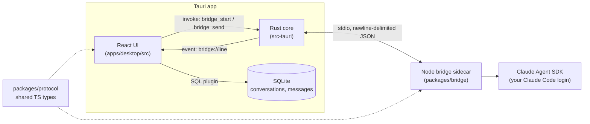

# Programish

A personal desktop app for prompting about code. It is a lightweight, fast replacement for a general chat app, with coding-focused tools and visuals, powered by your existing Claude Code login (no API key handling).

> **Status:** foundation phase. The shell, bridge wiring and database schema exist; chat is not built yet. See [CLAUDE.md](CLAUDE.md#phase-status).

<!-- Screenshots: add dark and light shell captures here (docs/screenshots/). -->

## Stack

- **Shell:** Tauri v2 (Rust)
- **Frontend:** React, TypeScript, Vite, Tailwind CSS v4, Zustand, in-repo shadcn/ui-style components
- **Claude backend:** a Node sidecar ("bridge") using `@anthropic-ai/claude-agent-sdk`, authenticated through your Claude Code login
- **Storage:** SQLite via the Tauri SQL plugin
- **Primary target:** Windows 11 (macOS and Linux kept working where cheap)

## Architecture



Rust only moves lines between the UI and the sidecar; the message types live in one place, `packages/protocol`.

## Prerequisites

| Tool                        | Why                   | Install (Windows)                                                        |
| --------------------------- | --------------------- | ------------------------------------------------------------------------ |
| Node.js 22+                 | frontend and bridge   | `winget install OpenJS.NodeJS.LTS`                                       |
| pnpm 10                     | workspaces            | `corepack enable` (then `corepack prepare pnpm@10.28.0 --activate`)      |
| Rust (stable)               | Tauri core            | `winget install Rustlang.Rustup`                                         |
| MSVC Build Tools + WebView2 | Tauri on Windows      | see the [Tauri prerequisites](https://v2.tauri.app/start/prerequisites/) |
| Claude Code, logged in      | bridge authentication | `npm i -g @anthropic-ai/claude-code`, then run `claude` once and sign in |

Linux additionally needs `libwebkit2gtk-4.1-dev libgtk-3-dev librsvg2-dev libayatana-appindicator3-dev patchelf`.

## Getting started

```sh
pnpm install
pnpm dev        # launches the Tauri app (builds the bridge first)
pnpm dev:web    # UI only in a browser; the bridge shows as offline
```

In the app, the sidebar footer shows the bridge status. It starts the sidecar, sends a `ping`, and displays the `pong` round-trip time; click it to ping again.

## Scripts

| Script                             | What it does                              |
| ---------------------------------- | ----------------------------------------- |
| `pnpm dev` / `pnpm dev:web`        | Run the desktop app / the UI in a browser |
| `pnpm build`                       | Build the bridge bundle and the frontend  |
| `pnpm lint` / `pnpm format`        | ESLint / Prettier (`format:check` in CI)  |
| `pnpm typecheck`                   | `tsc` in strict mode for every package    |
| `pnpm test`                        | Vitest in every package                   |
| `pnpm check`                       | Format check, lint, typecheck and tests   |
| `pnpm rust:fmt` / `pnpm rust:lint` | `cargo fmt` / `cargo clippy -D warnings`  |

## Repository layout

```
apps/desktop/            Tauri + React app
  src/                   UI (components/, stores/, lib/, styles/)
  src-tauri/             Rust core, SQLite migrations, capabilities
packages/protocol/       Shared message types and NDJSON helpers (source-only)
packages/bridge/         Node sidecar (bundled to dist/main.mjs with esbuild)
```

## License

[MIT](LICENSE)
