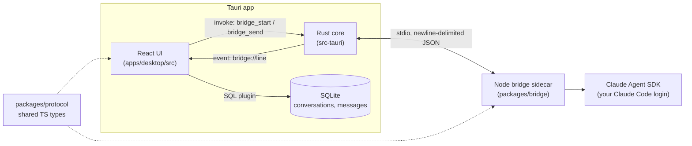

# Programish

A personal desktop app for prompting about code. It is a lightweight, fast replacement for a general chat app, with coding-focused tools and visuals, powered by your existing Claude Code login (no API key handling).

> **Status:** chat, code tools, usage and prompt library. Streaming conversations work end to end; see the feature list below and [CLAUDE.md](CLAUDE.md#phase-status) for what is next.

## Features

- Streaming chat on your Claude subscription (through your Claude Code login), with a Stop button that keeps the partial reply so you can carry on
- Model picker (Default, Sonnet, Opus, Haiku) and a per-conversation system prompt
- Plain chat by default; optional read-only file access (Read/Glob/Grep) for one folder you choose
- Markdown with GitHub tables
- Code blocks highlighted with Shiki (theme follows light/dark), with language and file name, line numbers, collapse for long blocks, a wrap toggle, copy, save as file and open in preview
- Diffs: unified diffs in a reply render as side-by-side or inline diffs with changed words highlighted; compare any two code blocks, or a block with its earlier version in the conversation
- Live preview panel for HTML, SVG, Mermaid and Markdown: sandboxed (no access to the app, bridge or files), tabs, refresh, mobile/tablet/desktop widths, a console pane, and it updates as a reply streams
- Keyboard shortcuts (`Ctrl+/` lists them): copy last code block, toggle preview, toggle diff layout
- Copy any message, edit and resend an earlier message, regenerate the last reply
- Multiline composer (Enter sends, Shift+Enter inserts a newline); paste, drop or pick text files as attachments
- Conversations saved in SQLite: rename, pin, delete (with confirmation), search by title and message content
- Friendly messages for logged-out, usage-limit (with reset time) and rate-limit situations
- Usage tracking from the SDK's own numbers: tokens (input, output, cache) per reply, running totals in the chat header, a Usage view with daily and weekly charts, per-model and top-conversation breakdowns, and your plan headroom and reset times when your login reports them. Cost is shown as "API-equivalent cost": informational on a subscription, not a bill
- Prompt library: saved prompts and system prompts with tags and `{{variables}}` (a small form fills them in), `/` in the message box to search and insert, JSON import and export
- Projects: group conversations and give a project a default system prompt; attach a library system prompt to a single chat
- Virtualized transcript and per-frame update batching so long chats and fast streams stay smooth

<!-- Screenshots: add dark and light shell captures here (docs/screenshots/). -->

## Stack

- **Shell:** Tauri v2 (Rust)
- **Frontend:** React, TypeScript, Vite, Tailwind CSS v4, Zustand, in-repo shadcn/ui-style components
- **Claude backend:** a Node sidecar ("bridge") using `@anthropic-ai/claude-agent-sdk`, authenticated through your Claude Code login
- **Storage:** SQLite via the Tauri SQL plugin
- **Primary target:** Windows 11 (macOS and Linux kept working where cheap)

## Architecture



Rust only moves lines between the UI and the sidecar; the message types live in one place, `packages/protocol`.

## Prerequisites

| Tool                        | Why                   | Install (Windows)                                                        |
| --------------------------- | --------------------- | ------------------------------------------------------------------------ |
| Node.js 22+                 | frontend and bridge   | `winget install OpenJS.NodeJS.LTS`                                       |
| pnpm 10                     | workspaces            | `corepack enable` (then `corepack prepare pnpm@10.28.0 --activate`)      |
| Rust (stable)               | Tauri core            | `winget install Rustlang.Rustup`                                         |
| MSVC Build Tools + WebView2 | Tauri on Windows      | see the [Tauri prerequisites](https://v2.tauri.app/start/prerequisites/) |
| Claude Code, logged in      | bridge authentication | `npm i -g @anthropic-ai/claude-code`, then run `claude` once and sign in |

Linux additionally needs `libwebkit2gtk-4.1-dev libgtk-3-dev librsvg2-dev libayatana-appindicator3-dev patchelf`.

## Getting started

```sh
pnpm install
pnpm dev        # launches the Tauri app (builds the bridge first)
pnpm dev:web    # UI only in a browser; the bridge shows as offline
```

In the app, the sidebar footer shows the bridge status (the `ping`/`pong` round-trip time); click it to ping again, or to restart the bridge if it stopped. Sign in once with `claude` in a terminal; Programish never asks for or stores credentials.

## Scripts

| Script                             | What it does                              |
| ---------------------------------- | ----------------------------------------- |
| `pnpm dev` / `pnpm dev:web`        | Run the desktop app / the UI in a browser |
| `pnpm build`                       | Build the bridge bundle and the frontend  |
| `pnpm lint` / `pnpm format`        | ESLint / Prettier (`format:check` in CI)  |
| `pnpm typecheck`                   | `tsc` in strict mode for every package    |
| `pnpm test`                        | Vitest in every package                   |
| `pnpm check`                       | Format check, lint, typecheck and tests   |
| `pnpm rust:fmt` / `pnpm rust:lint` | `cargo fmt` / `cargo clippy -D warnings`  |

## Repository layout

```
apps/desktop/            Tauri + React app
  src/                   UI (components/, stores/, lib/, styles/)
  src-tauri/             Rust core, SQLite migrations, capabilities
packages/protocol/       Shared message types and NDJSON helpers (source-only)
packages/bridge/         Node sidecar (bundled to dist/main.mjs with esbuild)
```

## License

[MIT](LICENSE)
