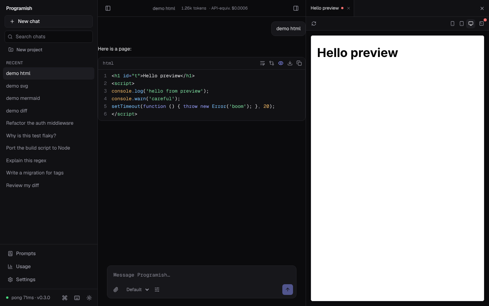
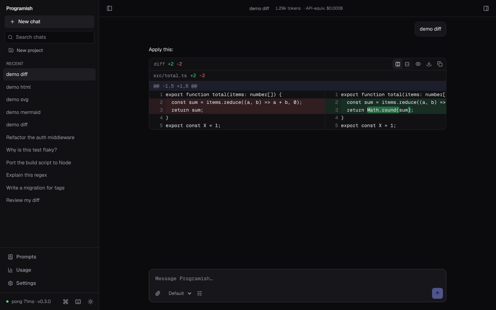
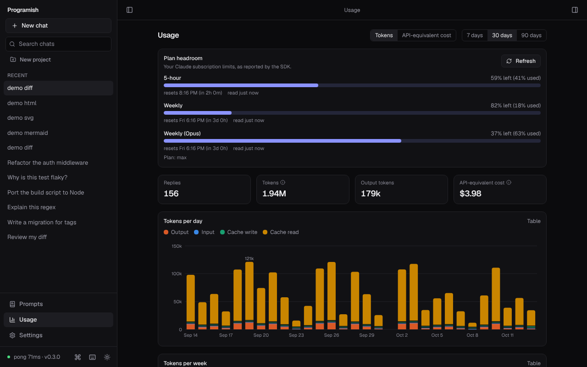
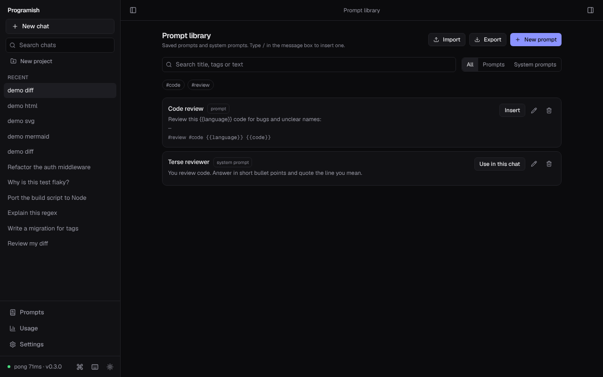
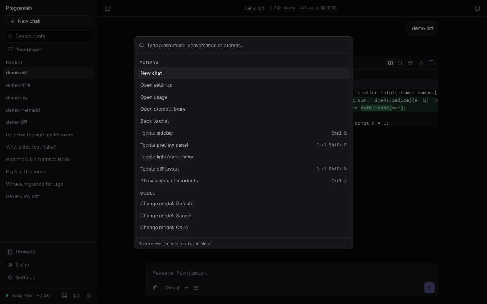
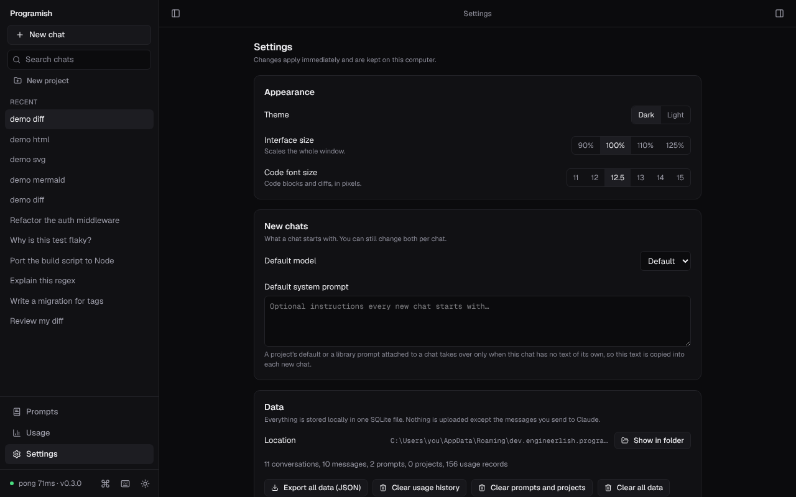
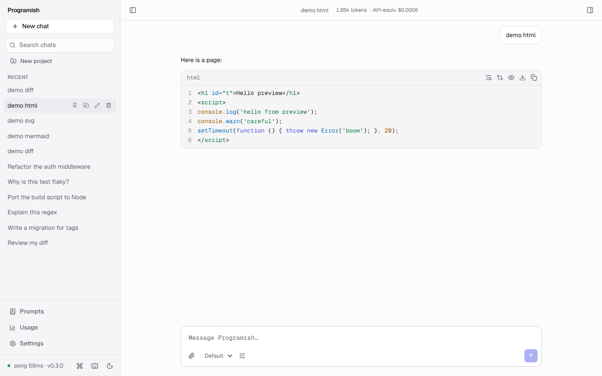
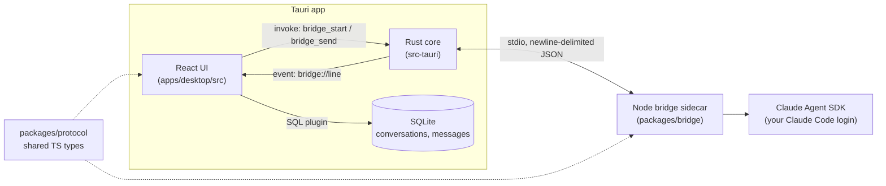

# Command Center

A lightweight desktop app for prompting about code, running on your own Claude Code login. No API key, no separate bill, and everything you save stays on your computer.



## Install

First, log in to Claude Code once: install it (`npm i -g @anthropic-ai/claude-code`), run `claude` and sign in. Command Center reads that login; it never asks for or stores credentials.

### macOS (Apple Silicon)

1. Download `Command-Center_<version>_aarch64.dmg` from the [latest release](https://github.com/milesceo/command-center/releases/latest), open it and drag **Command Center** to **Applications**. The app carries its own Node runtime, bridge and Claude runtime, so nothing else is needed.
2. The app is not signed with an Apple Developer ID yet, so macOS blocks the first launch. Right-click (Control-click) **Command Center** in Applications, choose **Open**, then **Open** again. On newer macOS versions, if the dialog only offers **Done**, open **System Settings > Privacy & Security** and choose **Open Anyway**. Or, in Terminal:

   ```bash
   xattr -dr com.apple.quarantine "/Applications/Command Center.app"
   ```

3. Optional, for the other AI agents: install the CLIs with Homebrew or npm (`npm i -g @openai/codex` for ChatGPT). The app finds them even when opened from the Dock, and their sign-in buttons open Terminal.

Each release lists SHA-256 checksums (`SHA256SUMS-macos.txt`). To build from source, see [docs/macos.md](docs/macos.md) (Xcode Command Line Tools via `xcode-select --install`, Homebrew, Rust and pnpm). Intel Macs build from source but are untested.

### Windows

1. Download `Command-Center_<version>_x64-setup.exe` from the [latest release](https://github.com/milesceo/command-center/releases/latest) and run it. It installs for your user only and needs no admin rights or developer tools: the app carries its own Node runtime, bridge and Claude runtime.
2. The installer is not code signed yet, so Windows SmartScreen may warn on first run: choose **More info**, then **Run anyway**. Each release lists a SHA-256 checksum (`SHA256SUMS.txt`) if you want to verify the download.

macOS on Apple Silicon and Windows 11 on x64 are the supported targets. Linux builds from source but is untested.

## Features

- **Chat** on your Claude subscription, with a Stop button that keeps the partial reply, a model picker (Default, Sonnet, Opus, Haiku) and a system prompt per conversation. Plain chat by default; optional read-only file access (Read, Glob, Grep) for one folder you choose.
- **Conversations** saved in SQLite: rename, pin, delete with confirmation, search by title and message text, edit and resend, regenerate, and attach text files.
- **Code blocks** highlighted with Shiki (the theme follows light and dark), with line numbers, collapse, wrap, copy, save as file and open in preview.
- **Diffs** in replies as side-by-side or inline views with changed words marked, plus comparison of any two code blocks.
- **Live preview** for HTML, SVG, Mermaid and Markdown. Previewed code is sandboxed (no access to the app, your files or the network) and updates while a reply streams.
- **Usage** from the numbers the SDK reports: tokens per reply, totals in the chat header, daily and weekly charts, per-model and per-conversation breakdowns, and plan headroom when your login exposes it. Cost is shown as "API-equivalent cost": informational on a subscription, not a bill.
- **Prompt library** with `{{variables}}`, `/` to insert from the message box, JSON import and export, and **projects** that group conversations and carry a default system prompt.
- **Command palette** (`⌘K` on macOS, `Ctrl+K` on Windows) and **settings** (theme, interface and code font size, defaults for new chats, data location, export and clear).
- Keyboard shortcuts (`⌘/` or `Ctrl+/` lists them), keyboard-navigable dialogs and WCAG AA contrast in both themes.

| Diffs                                                | Usage                                                 |
| ---------------------------------------------------- | ----------------------------------------------------- |
|          |         |
| **Prompt library**                                   | **Command palette**                                   |
|  |  |
| **Settings**                                         | **Light theme**                                       |
|       |        |

The usage charts above show sample data. Screenshots are regenerated by `apps/desktop/e2e/screenshots.mjs`.

## Stack

- **Shell:** Tauri v2 (Rust)
- **Frontend:** React, TypeScript, Vite, Tailwind CSS v4, Zustand, in-repo shadcn/ui-style components
- **Claude backend:** a Node sidecar ("bridge") using `@anthropic-ai/claude-agent-sdk`, authenticated through your Claude Code login
- **Storage:** SQLite via the Tauri SQL plugin
- **Targets:** macOS (Apple Silicon) and Windows 11; Linux builds but is untested

## Architecture



Rust only moves lines between the UI and the sidecar; the message types live in one place, `packages/protocol`.

## Building from source

### Prerequisites

| Tool                        | Why                   | Install (Windows)                                                        |
| --------------------------- | --------------------- | ------------------------------------------------------------------------ |
| Node.js 22+                 | frontend and bridge   | `winget install OpenJS.NodeJS.LTS`                                       |
| pnpm 10                     | workspaces            | `corepack enable` (then `corepack prepare pnpm@10.28.0 --activate`)      |
| Rust (stable)               | Tauri core            | `winget install Rustlang.Rustup`                                         |
| MSVC Build Tools + WebView2 | Tauri on Windows      | see the [Tauri prerequisites](https://v2.tauri.app/start/prerequisites/) |
| Claude Code, logged in      | bridge authentication | `npm i -g @anthropic-ai/claude-code`, then run `claude` once and sign in |

macOS needs the Xcode Command Line Tools (`xcode-select --install`) and Homebrew (`brew install rustup gh`, then `rustup-init -y` and `corepack enable pnpm`); see [docs/macos.md](docs/macos.md).

Linux additionally needs `libwebkit2gtk-4.1-dev libgtk-3-dev librsvg2-dev libayatana-appindicator3-dev patchelf`.

### Getting started

```sh
pnpm install
pnpm dev        # launches the Tauri app (builds the bridge first)
pnpm dev:web    # UI only in a browser; the bridge shows as offline
```

In the app, the sidebar footer shows the bridge status (the `ping`/`pong` round-trip time); click it to ping again, or to restart the bridge if it stopped. Sign in once with `claude` in a terminal; Command Center never asks for or stores credentials.

## Scripts

| Script                             | What it does                               |
| ---------------------------------- | ------------------------------------------ |
| `pnpm dev` / `pnpm dev:web`        | Run the desktop app / the UI in a browser  |
| `pnpm build`                       | Build the bridge bundle and the frontend   |
| `pnpm lint` / `pnpm format`        | ESLint / Prettier (`format:check` in CI)   |
| `pnpm typecheck`                   | `tsc` in strict mode for every package     |
| `pnpm test`                        | Vitest in every package                    |
| `pnpm check`                       | Format check, lint, typecheck and tests    |
| `pnpm rust:fmt` / `pnpm rust:lint` | `cargo fmt` / `cargo clippy -D warnings`   |
| `pnpm sidecar`                     | Assemble the bundled Node, bridge, runtime |

## Repository layout

```
apps/desktop/            Tauri + React app
  src/                   UI (components/, stores/, lib/, styles/)
  src-tauri/             Rust core, SQLite migrations, capabilities
packages/protocol/       Shared message types and NDJSON helpers (source-only)
packages/bridge/         Node sidecar (bundled to dist/main.mjs with esbuild)
scripts/                 Sidecar assembly, release tooling and the installed-app smoke test
docs/screenshots/        README images
docs/prompts/            The prompts used to build Command Center, one per session
.claude/agents/          Claude Code subagents used while developing Command Center (not part of the app)
```

## Your data

One SQLite file in the app's config folder (Settings shows the exact path and can open it). Nothing is uploaded except the messages you send to Claude. Settings can export everything as JSON and clear usage history, the prompt library, or all data.

## Releasing

Versions follow [SemVer](https://semver.org/) and [CHANGELOG.md](CHANGELOG.md) follows [Keep a Changelog](https://keepachangelog.com/). To release: update the changelog and bump the version in `package.json`, `apps/desktop/package.json`, `src-tauri/tauri.conf.json` and `src-tauri/Cargo.toml`, merge, then push a tag such as `v1.0.1`. The [release workflow](.github/workflows/release.yml) builds the installer on Windows, installs it silently, smoke-tests the installed files, launches the app and checks that it starts its bundled bridge, and then publishes the release with the changelog section as its notes. In parallel it builds an unsigned dmg on macOS (Apple Silicon), installs the app from the dmg, smoke-tests it, launches it and checks that it starts its bundled bridge; the dmg and `SHA256SUMS-macos.txt` are attached to the same release. Running the workflow by hand does everything except publish.

`pnpm sidecar` assembles the bundled pieces locally (`node`, the bridge bundle and the Claude runtime); `pnpm --filter @command-center/desktop tauri build` makes an installer for the machine it runs on (an `.app` and `.dmg` on macOS).

## License

[MIT](LICENSE)
